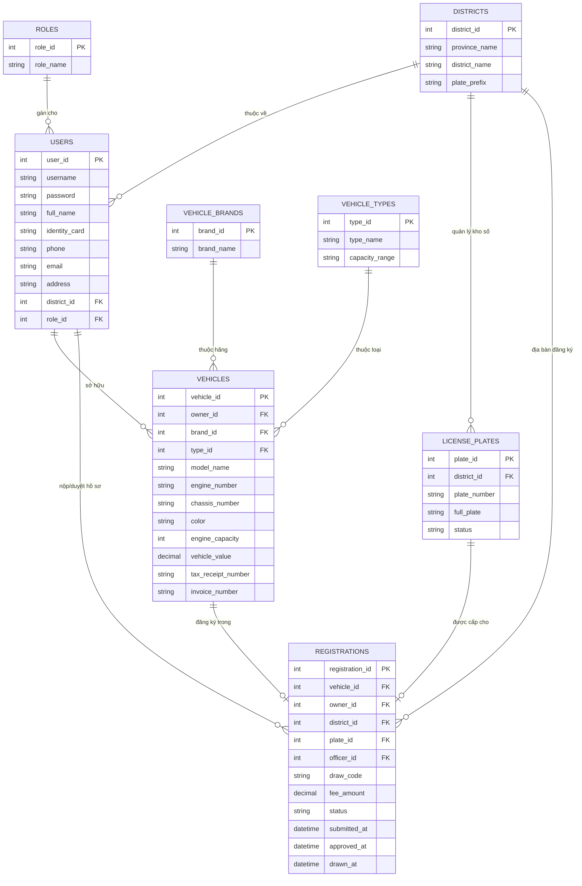

# Đặc Tả Cơ Sở Dữ Liệu - Hệ Thống Đăng Ký và Bấm Biển Số Xe Máy

Tài liệu này mô tả chi tiết thiết kế cơ sở dữ liệu (Relational Database Schema) cho dự án **Đăng ký xe và Bấm biển số xe máy** sử dụng **Java / Servlet / JSP** và hệ quản trị cơ sở dữ liệu **MySQL**.

---

## 1. Sơ Đồ Quan Hệ Thực Thể (Mermaid ER Diagram)

---

## 2. Chi Tiết Các Bảng Dữ Liệu (Tables & Columns)

### 2.1 Bảng `roles` (Vai trò)
Quản lý các nhóm quyền truy cập trong hệ thống.
| Tên Cột | Kiểu Dữ Liệu | Ràng Buộc | Mô Tả |
| :--- | :--- | :--- | :--- |
| `role_id` | INT | PK, Auto Increment | Mã vai trò |
| `role_name` | VARCHAR(50) | NOT NULL, UNIQUE | Tên vai trò (`ROLE_ADMIN`, `ROLE_OFFICER`, `ROLE_USER`) |

### 2.2 Bảng `districts` (Danh mục Quận/Huyện & Đầu biển)
Quản lý danh mục quận/huyện và mã ký hiệu biển số (ví dụ: `29-H1`, `59-F1`).
| Tên Cột | Kiểu Dữ Liệu | Ràng Buộc | Mô Tả |
| :--- | :--- | :--- | :--- |
| `district_id` | INT | PK, Auto Increment | Mã quận/huyện |
| `province_name` | VARCHAR(100) | NOT NULL | Tên Tỉnh / Thành phố (vd: Hà Nội, TP.HCM) |
| `district_name` | VARCHAR(100) | NOT NULL | Tên Quận / Huyện (vd: Cầu Giấy, Quận 1) |
| `plate_prefix` | VARCHAR(10) | NOT NULL, UNIQUE | Ký hiệu đầu biển (vd: `29-P1`, `59-F1`) |

### 2.3 Bảng `users` (Tài khoản người dùng)
Lưu thông tin chủ xe và cán bộ xử lý hồ sơ.
| Tên Cột | Kiểu Dữ Liệu | Ràng Buộc | Mô Tả |
| :--- | :--- | :--- | :--- |
| `user_id` | INT | PK, Auto Increment | Mã người dùng |
| `username` | VARCHAR(50) | NOT NULL, UNIQUE | Tên đăng nhập |
| `password` | VARCHAR(255) | NOT NULL | Mật khẩu (đã mã hóa SHA-256 / BCrypt) |
| `full_name` | VARCHAR(100) | NOT NULL | Họ và tên |
| `identity_card` | VARCHAR(20) | NOT NULL, UNIQUE | Số CCCD / CMND |
| `phone` | VARCHAR(15) | NOT NULL | Số điện thoại |
| `email` | VARCHAR(100) | NULL | Địa chỉ Email |
| `address` | VARCHAR(255) | NOT NULL | Địa chỉ thường trú |
| `district_id` | INT | FK -> `districts` | Quận/Huyện thường trú |
| `role_id` | INT | FK -> `roles` | Vai trò hệ thống |
| `created_at` | DATETIME | DEFAULT CURRENT_TIMESTAMP | Ngày tạo tài khoản |

### 2.4 Bảng `vehicle_brands` (Hãng sản xuất)
| Tên Cột | Kiểu Dữ Liệu | Ràng Buộc | Mô Tả |
| :--- | :--- | :--- | :--- |
| `brand_id` | INT | PK, Auto Increment | Mã hãng xe |
| `brand_name` | VARCHAR(50) | NOT NULL, UNIQUE | Tên hãng (Honda, Yamaha, VinFast...) |

### 2.5 Bảng `vehicle_types` (Phân loại xe)
| Tên Cột | Kiểu Dữ Liệu | Ràng Buộc | Mô Tả |
| :--- | :--- | :--- | :--- |
| `type_id` | INT | PK, Auto Increment | Mã loại xe |
| `type_name` | VARCHAR(50) | NOT NULL | Tên loại xe (Xe số, Xe tay ga, Xe điện...) |
| `capacity_range` | VARCHAR(50) | NULL | Dung tích xi-lanh (`< 50cc`, `50-175cc`, `> 175cc`) |

### 2.6 Bảng `vehicles` (Thông tin xe đăng ký)
Lưu trữ chi tiết các thông số kỹ thuật và chứng từ của phương tiện.
| Tên Cột | Kiểu Dữ Liệu | Ràng Buộc | Mô Tả |
| :--- | :--- | :--- | :--- |
| `vehicle_id` | INT | PK, Auto Increment | Mã xe |
| `owner_id` | INT | FK -> `users` | Mã chủ xe sở hữu |
| `brand_id` | INT | FK -> `vehicle_brands` | Hãng xe |
| `type_id` | INT | FK -> `vehicle_types` | Loại xe |
| `model_name` | VARCHAR(100) | NOT NULL | Tên dòng xe (Wave Alpha, SH 125i...) |
| `engine_number` | VARCHAR(50) | NOT NULL, UNIQUE | Số máy |
| `chassis_number` | VARCHAR(50) | NOT NULL, UNIQUE | Số khung (VIN) |
| `color` | VARCHAR(30) | NOT NULL | Màu sơn |
| `engine_capacity` | INT | NOT NULL | Dung tích thực (cc) |
| `vehicle_value` | DECIMAL(12,2) | NOT NULL | Giá trị xe (VNĐ, tính thuế/lệ phí) |
| `tax_receipt_number`| VARCHAR(50) | NOT NULL | Mã biên lai nộp lệ phí trước bạ |
| `invoice_number` | VARCHAR(50) | NOT NULL | Mã hóa đơn GTGT (VAT) |
| `created_at` | DATETIME | DEFAULT CURRENT_TIMESTAMP | Ngày thêm xe |

### 2.7 Bảng `license_plates` (Kho biển số)
Quản lý tập hợp dải biển số có thể cấp cho từng địa bàn.
| Tên Cột | Kiểu Dữ Liệu | Ràng Buộc | Mô Tả |
| :--- | :--- | :--- | :--- |
| `plate_id` | INT | PK, Auto Increment | Mã biển số |
| `district_id` | INT | FK -> `districts` | Thuộc kho biển số quận/huyện |
| `plate_number` | VARCHAR(10) | NOT NULL | Dãy 5 số (vd: `123.45`, `888.88`) |
| `full_plate` | VARCHAR(20) | NOT NULL, UNIQUE | Biển đầy đủ (vd: `29-P1 123.45`) |
| `status` | ENUM | NOT NULL | Trạng thái (`AVAILABLE`, `ASSIGNED`, `BLOCKED`) |
| `assigned_at` | DATETIME | NULL | Thời điểm biển số được cấp |

### 2.8 Bảng `registrations` (Hồ sơ đăng ký & Bấm biển)
Bảng trung tâm quản lý toàn bộ vòng đời hồ sơ đăng ký và bấm biển số.
| Tên Cột | Kiểu Dữ Liệu | Ràng Buộc | Mô Tả |
| :--- | :--- | :--- | :--- |
| `registration_id` | INT | PK, Auto Increment | Mã hồ sơ đăng ký |
| `vehicle_id` | INT | FK -> `vehicles`, UNIQUE | Mã xe cần đăng ký |
| `owner_id` | INT | FK -> `users` | Chủ xe nộp hồ sơ |
| `district_id` | INT | FK -> `districts` | Nơi đăng ký (xác định kho biển) |
| `plate_id` | INT | FK -> `license_plates`, NULL | Biển số được cấp (sau khi bấm số) |
| `officer_id` | INT | FK -> `users`, NULL | Cán bộ xét duyệt |
| `draw_code` | VARCHAR(20) | NULL, UNIQUE | Mã OTP / Mã xác thực cấp cho lượt bấm biển |
| `fee_amount` | DECIMAL(10,2) | NULL | Lệ phí đăng ký và cấp biển (VNĐ) |
| `status` | ENUM | NOT NULL | `PENDING` (Mới nộp), `APPROVED` (Đã duyệt, chờ bấm), `DRAWN` (Đã bấm biển), `REJECTED` (Từ chối) |
| `rejection_reason` | VARCHAR(255) | NULL | Lý do nếu hồ sơ bị từ chối |
| `submitted_at` | DATETIME | DEFAULT CURRENT_TIMESTAMP | Ngày nộp hồ sơ |
| `approved_at` | DATETIME | NULL | Ngày cán bộ duyệt hồ sơ |
| `drawn_at` | DATETIME | NULL | Ngày chủ xe bấm biển thành công |
